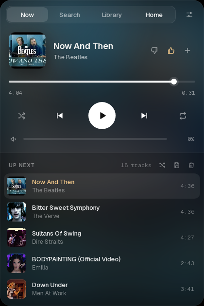

# ytm-bar for Arch (i3 + polybar)

YouTube Music in your polybar, with no app and no browser tab.




A now-playing pill in the bar and a player popup under it. The popup has
search, your library, home, likes, an editable queue, playlists, a sleep timer,
an equalizer and volume levelling. There's also `ytm-tui`, the same player in a
terminal. Search and radio come from
[ytmusicapi](https://github.com/sigma67/ytmusicapi); audio plays through
[mpv](https://mpv.io/) + [yt-dlp](https://github.com/yt-dlp/yt-dlp) in a small
user service.

This is the `arch` branch, made for i3 and polybar on Arch Linux. The Omarchy
widget lives on `main`.

## Install

```bash
sudo pacman -Syu mpv yt-dlp python-ytmusicapi python-gobject webkit2gtk-4.1
sudo pacman -S mpv-mpris libnotify kitty     # optional: MPRIS, notifications, Open in TUI
./install.sh --i3          # --no-bindings to skip Super+Alt+M
```

The installer links `ytm-bar`, `ytm-tui` and `ytm-panel` into `~/.local/bin`,
enables `ytm-bar.service` and adds a block to your i3 config. Then add the bar
module:

1. Copy [`i3/polybar.ini`](i3/polybar.ini) into your polybar config.
2. Put `ytm` in `modules-right`.
3. Run `polybar-msg cmd restart`.

The pill uses the bar's third font (`font-2`) for the wave. Any Nerd Font works.

**Or as a package**, with the [`PKGBUILD`](PKGBUILD) (`makepkg -si`). It installs
to `/usr/lib/ytm-bar`. Afterwards, run `systemctl --user enable --now ytm-bar`.
Then add `/usr/lib/ytm-bar/i3/i3.config` to your i3 config and the polybar
module, with `~/.local/bin/` removed from the commands.

**Log in (optional)**, for likes, your library, playlists and a personal home:
⚙ Settings → **Sign in with Google**. A Chromium window opens; sign in and it
closes by itself.

## Use

| On the pill | |
|---|---|
| Click | open the popup (click again, or anywhere else, to close) |
| Right-click · `Super+Alt+M` | open the popup in search |
| Middle-click | play / pause |
| Scroll | previous / next |

The pill shows a dot wave, the title and the time. It's amber and moving while
playing, and grey while paused.

- **Now** shows the cover, controls, volume and the up-next queue. The card takes
  its colour from the cover.
  - **+** adds the song to one of your playlists.
  - Drag queue rows to reorder them; hover a row to play it next or remove it.
  - The queue's buttons shuffle it, save it as a new playlist or clear it.
  - The radio for the current song keeps the queue going, with repeat on too.
- **Search** keeps your recent searches. **Library** and **Home**: click a song to
  play it; albums, artists and playlists open as a page.
- **⚙ Settings**:
  - Sleep timer, which fades out before it pauses.
  - Equalizer.
  - **Even out volume**, so songs play at a similar loudness.
  - Volume boost.
  - **Song notifications**, with the cover, through dunst or any notification daemon.
  - Audio output.
  - Open in TUI.
  - Account.

Songs play gapless. When you're logged in, what you play goes into your YouTube
Music history, so your home page and radio keep learning. If YouTube refuses a
song, the popup and a notification say so instead of skipping it silently.
After a restart or reboot your queue comes back, paused where you left it.

### In a terminal

Run `ytm-tui` (or Settings → **Open in TUI**). The key hints are always at the
bottom: `space` play/pause, `n`/`p` next/previous, `/` search, `q` quit.

## Command line

Every command prints JSON:

```
ytm-bar toggle | next | previous | like | shuffle | repeat
ytm-bar search QUERY | play VIDEO_ID | volume PERCENT | sleep MINUTES|end|off
ytm-bar playlists | addto PLAYLIST_ID VIDEO_ID | savequeue TITLE
ytm-bar clearqueue | shufflequeue | normalize | notify | devices | device NAME
ytm-bar song | queue | signin | logout          # ytm-bar --help for all
```

## Troubleshooting

- **Pill shows only a grey note**: nothing is loaded, or the service is stopped
  (`systemctl --user status ytm-bar`).
- **Songs skip** ("YouTube wouldn't play it"): update with `sudo pacman -Syu`.
  YouTube changes break yt-dlp for a few days at a time. `bin/ytm-ytdl` waits
  until YouTube makes each song available, which mpv 0.41 doesn't do yet.
- **Popup in the wrong place**: it opens under i3's top dock on the monitor
  with the mouse; the bar must be a dock (no `override-redirect`).
- **Edited the code?** `systemctl --user restart ytm-bar` for `bin/ytm-bar`;
  `pkill -f ytm-panel` for the popup (the next click starts it again).

## Notes

- Audio is ~130 kbps Opus. Age-restricted songs don't play.
- Your login is stored only in `~/.config/ytm-bar` (readable by you alone).
- Fonts: [Geist](https://github.com/vercel/geist-font), under the SIL Open Font
  License (`fonts/OFL.txt`).
- Tests: `python3 tests/test_cli.py`. Uninstall: `./uninstall.sh`
  (`--purge` also removes the login).
