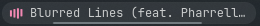
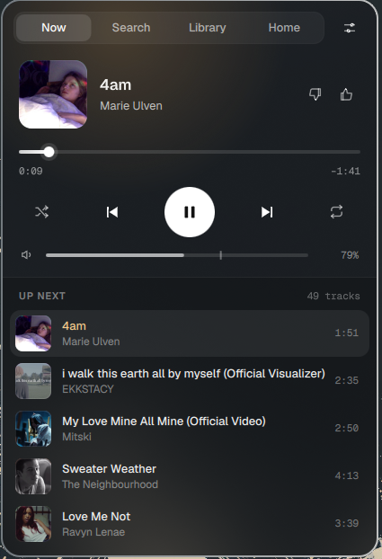
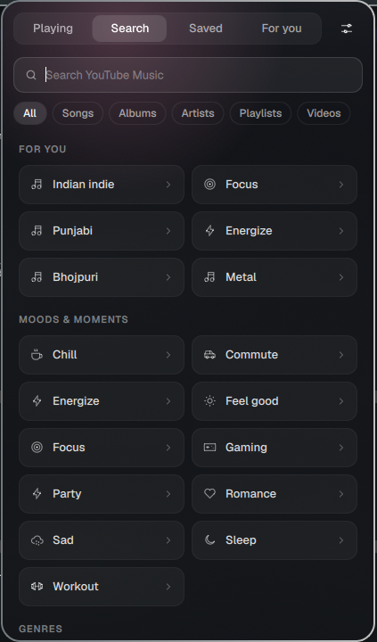
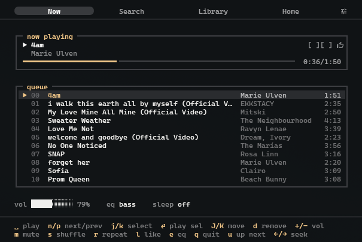

# ytm-bar

YouTube Music in the [Omarchy](https://omarchy.org/) bar — no app, no browser tab.



<p>
  
  
</p>

A now-playing pill and a player popup that takes its colour from the cover:
a waveform seek bar, the up-next queue as covers, search with moods and genres
to browse, your saved music and playlists, likes, a sleep timer, equalizer and
volume boost — plus `ytm-tui`, the same player in a terminal. Search and radio come from
[ytmusicapi](https://github.com/sigma67/ytmusicapi); audio plays through
[mpv](https://mpv.io/) + [yt-dlp](https://github.com/yt-dlp/yt-dlp) in a small
user service.

## Install

From the Omarchy plugin marketplace, or straight from GitHub:

```bash
omarchy pkg add mpv yt-dlp python-ytmusicapi python-pillow
omarchy plugin add https://github.com/crsstha/ytm-bar --enable
```

The widget appears in the bar, and the player service starts by itself when the
bar loads.

**Dependencies** — required: `mpv`, `yt-dlp`, `python-ytmusicapi`. Optional:
`mpv-mpris` (media keys), `python-pillow` (cover colours, cover art in the
terminal), Chromium, Chrome or Brave (Sign in with Google). Without
`python-pillow` the card stays amber instead of taking the cover's colour.

**Extras (optional)** — run `install.sh` from the plugin folder:

```bash
~/.config/omarchy/plugins/crsstha.ytmusic/install.sh    # --no-bindings to skip the keybinding
```

It adds the `ytm-bar` and `ytm-tui` commands to `~/.local/bin`, a
`ytm-bar.service` user unit (so the player, and your queue, are back at login),
and a block in `~/.config/hypr/bindings.lua` between `ytm-bar` marker lines:
`Super+Alt+M`, blur behind the popup, and floating windows for sign-in and
`ytm-tui`. Nothing else in your configuration is changed.

**Log in (optional)** — for likes, your library and a personal home page:
⚙ Settings → **Sign in with Google**. A small window opens on Google's sign-in
page; once you're through to YouTube Music it closes by itself, within a few
seconds. No Chromium? Use **Paste headers** instead.

## Use

| In the bar | |
|---|---|
| Click | open the popup |
| Right-click · `Super+Alt+M` | open the popup in search |
| Middle-click | play / pause |
| Scroll | previous / next |

- **Playing** — controls, volume and the up-next queue (drag to reorder, hover to
  play next or remove). The radio for the current song keeps the queue going.
- **Search** — recent searches and mood and genre tiles before you type, then
  results by type. **Saved · For you** — your library and YouTube's picks.
  Click a song to play it; albums, artists, playlists and moods open as a page.
- **Playlists** — the playlist button next to the hearts adds the current song
  to one of your playlists, or to a new one; **Saved → New playlist** makes an
  empty one. New playlists are private. On someone else's playlist (say, from
  For you), **Save** adds it to Saved.
- **⚙ Settings** — sleep timer, equalizer, volume boost, **Open in TUI**, account.

Media keys work too. When another app plays sound — a video, a call — the
music pauses, and carries on once it stops (Settings → **Pause for other
sounds**, or `ytm-bar autopause`). After a restart or reboot your queue comes
back, paused where you left it.

### In a terminal



Open it from Settings → **Open in TUI**, or run `ytm-tui` (after `install.sh`;
otherwise it's `~/.config/omarchy/plugins/crsstha.ytmusic/bin/ytm-tui`). With
`install.sh`'s window rule it floats in the middle of the screen. The key hints
are always at the bottom; the main ones:

| Keys | |
|---|---|
| `space` · `n` / `p` | play / pause · next / previous |
| `j` / `k` · `Enter` | select · play |
| `J` / `K` · `d` · `u` | move · remove · play next |
| `+` / `-` · `m` · `e` | volume · mute · next eq preset |
| `s` · `r` · `l` | shuffle · repeat · like |
| `[` / `]` or `1`–`4` · `,` | previous / next tab · settings |
| `/` · `Esc` · `g` / `G` · `q` | type a search · leave the box or go back · top / end of a list · quit |

## Command line

Everything also works from the shell (`ytm-bar` after `install.sh`, otherwise
`~/.config/omarchy/plugins/crsstha.ytmusic/bin/ytm-bar`); each command prints JSON:

```
ytm-bar toggle | next | previous | like | shuffle | repeat
ytm-bar search QUERY | play VIDEO_ID | volume PERCENT | sleep MINUTES|end|off
ytm-bar playlists | newplaylist TITLE [VIDEO_ID] | addto PLAYLIST_ID VIDEO_ID
ytm-bar save | unsave PLAYLIST_ID
ytm-bar song | queue | stats | signin | logout  # ytm-bar --help for all
```

## Troubleshooting

- **Pill stays dimmed** — the service is stopped. Click the pill to start it, or
  `systemctl --user status ytm-bar` if you ran `install.sh`.
- **"YouTube ended this login"** — sign in again from Settings.
- **Search fails or songs skip** — ytmusicapi or yt-dlp needs an update
  (`omarchy update`); YouTube changes break them for a few days at a time.
- **No blur behind the popup** — run `install.sh` (it adds the blur rule), then
  `omarchy restart shell`. Updating from 1.0.0? Run it again: the rule changed.
  Omarchy also turns blur off by default; to turn it on (for all see-through
  windows, not just the card) add this to `~/.config/hypr/looknfeel.lua`:
  `hl.config({ decoration = { blur = { enabled = true, size = 12, passes = 3 } } })`
- **Card stays amber** — `python-pillow` is missing: `omarchy pkg add
  python-pillow`, then `systemctl --user restart ytm-bar`.
- **Edited the code?** `omarchy restart shell` for the QML,
  `systemctl --user restart ytm-bar` for `bin/ytm-bar`.

## Notes

- Audio is ~130 kbps Opus; age-restricted songs don't play, and plays aren't
  added to your YouTube Music history.
- Your login is stored only in `~/.config/ytm-bar` (readable by you alone).
- Fonts: [Geist](https://github.com/vercel/geist-font), under the SIL Open Font
  License (`fonts/OFL.txt`).
- Tests: `python3 tests/test_cli.py`.
- Built by crsstha with [Claude](https://claude.ai) (Anthropic) as co-author.

## Remove

```bash
~/.config/omarchy/plugins/crsstha.ytmusic/uninstall.sh   # only if you ran install.sh
omarchy plugin remove crsstha.ytmusic
```

`uninstall.sh` stops the service and removes what `install.sh` added. Your
login stays in `~/.config/ytm-bar` — `uninstall.sh --purge` removes it too
(or delete that folder).
